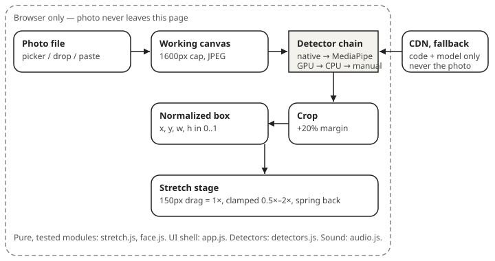

# Face Stretch Playground

[](https://github.com/enonymous1/face-stretch-playground/actions/workflows/test.yml)

## Description

Upload a photo, find a face in it, and stretch it like the Mario 64
title screen — drag the face, let go, and it springs back.

No server, no upload, no account. Detection and cropping run entirely
in your browser, so your photo never leaves the page. If your browser
has no built-in face detector, a model is downloaded from a CDN as a
fallback — that download is code and model only, never your photo.

<!-- VISUAL 1 — Demo GIF (see "Visual assets" below for the capture spec).
     Place here, directly after this paragraph, before "Prerequisites":
      -->
<!-- Capture: play stage, one face, drag wide to ~1.8x, release to spring
     back, then drag tall, then squish. 5-8 second loop, cursor visible,
     720px wide max. Capture from a real run with a consented photo.
     Do not fake it with a drawn face or a stock photo you do not have
     rights to use. -->

## Prerequisites

Running the toy (no install):

- A modern browser. Face detection support varies, and the app degrades
  gracefully in every case:

  | Browser | Detection path |
  | ------- | -------------- |
  | Chrome / Edge (desktop and Android) | Built-in `FaceDetector`, no download |
  | Firefox / Safari, or Chrome without `FaceDetector` | MediaPipe BlazeFace, downloaded from CDN on first use |
  | Any browser, offline | Manual box — draw it yourself, play still works |

- Internet access only for the MediaPipe fallback path. The built-in
  detector and the manual box work fully offline.

Running the tests (optional, not needed to play):

- Node.js 20 or later. No npm packages are installed — the tests use
  only Node's built-in test runner.
- Python 3 (for the local server in "Local Development"), or any
  static file server.

## Installation

There is nothing to install and no build step. Clone the repository,
or download it as a zip and extract it:

```sh
git clone https://github.com/enonymous1/face-stretch-playground.git
cd face-stretch-playground
```

No `npm install`, no environment variables, no API keys, no server
configuration. The whole app is static files.

## Local Development

The simplest way to play is to open the file directly:

```sh
# macOS / Linux: open index.html in your default browser
open index.html
```

That works for the built-in detector and the manual box. For the
MediaPipe fallback path, serve the folder over HTTP instead — module
imports and model fetches are more reliable served than from `file://`:

```sh
python3 -m http.server 8000
# then open http://localhost:8000/
```

### How it works



1. **Pick a photo** — file picker, drag-and-drop, or paste.
   Phone photos are auto-oriented, and the working copy is capped at
   1600px on the long side (the play face is only shown at 320px, so
   a larger copy buys nothing and costs memory).

   <!-- VISUAL 2 — Pick-stage screenshot (see "Visual assets").
        Place here, directly after this paragraph, before step 2:
         -->
   <!-- Capture: step 2 with a two-face photo, yellow box on one face,
        red "Selected" box on the larger face, resize handle visible.
        1200px wide max, same consented photo as the demo GIF. -->

2. **Pick the face** — detection runs in this order, cheapest first:
   1. The browser's built-in `FaceDetector` when present.
   2. MediaPipe BlazeFace Short Range, GPU delegate first, CPU on
      failure, loaded from CDN only if the built-in detector is
      missing or failed.
   3. A manual box, which always works: tap *Draw a box instead* and
      drag on the photo. The largest detected face is selected by
      default; tap any other box to switch, drag the selected box to
      move it, or drag its bottom-right corner to resize it.

3. **Stretch it** — the selected face is cropped (with a 20% margin so
   forehead and chin come along) and shown on its own, Mario-style.
   Drag to stretch, release to spring back. Stretch math is reused
   from the jpl-dev avatar easter egg: 150px of drag is 1× of scale,
   clamped to 0.5×–2×, with an overshoot spring on release.
   `Pull wide` / `Pull tall` / `Squish` buttons and arrow keys do the
   same thing without a pointer, and the spring is skipped under
   `prefers-reduced-motion`. The boing is a tiny WebAudio synth —
   no audio files — and can be toggled off.

### Project structure

```text
index.html                 Three steps: upload, pick, play
styles.css                 Layout, box overlay, play-stage spring
js/config.js               Every tunable number, in one place
js/stretch.js              Drag -> scale math (pure, tested)
js/face.js                 Normalized boxes + gesture math (pure, tested)
js/detectors.js            Native / MediaPipe detection behind one contract
js/audio.js                WebAudio boing, with its context lifecycle
js/app.js                  UI shell only: DOM, pointers, state
tests/                     Node tests for the pure modules + load order
docs/architecture.svg      Diagram above
```

Load order in `index.html` matters — classic scripts, no bundler —
and `tests/load-order.test.js` guards it: config, stretch, face,
detectors, audio, then app.

### Testing

```sh
node --test tests/stretch.test.js tests/face.test.js tests/load-order.test.js
```

21 tests, all passing. They cover stretch math, box normalization,
largest-face pick, crop math, move/resize/draw gestures, config
sanity, script load order, and that every id `app.js` looks up exists
in `index.html`.

What they do **not** cover, honestly: `app.js` itself. It needs a
browser (DOM, pointers, canvas, detectors), and there is no DOM test
harness in this repo by design — no dependencies. The mitigation is
architectural, not a test: the gesture and detector logic that used to
live inline in `app.js` was extracted into pure, tested modules, so
the untested shell is as thin as possible. A live browser playthrough
with a real photo remains the gate for a release.

## Deployment

This is a static site. There is no build, no server, and no
environment to configure, so deployment is "host the folder":

**GitHub Pages (recommended for this repo):**

1. Push `main` to GitHub.
2. Settings → Pages → Source: *Deploy from a branch*.
3. Branch: `main`, folder: `/ (root)`, Save.
4. The site is live at `https://enonymous1.github.io/face-stretch-playground/`.

**Any other static host** (Netlify, Cloudflare Pages, Vercel, S3, or
a plain web server): upload the repository contents as-is. No build
command, no output directory, no rewrites. `index.html` at the root
is the entry point.

After deployment, verify with a real photo in a real browser: upload,
detect, pick, stretch, release. The first CI run after push is also
still a gate — the workflow is in `.github/workflows/test.yml`
(Node 22, JS syntax check + tests on push and pull request).

## Limitations and privacy

- Face detection is best-effort, not a guarantee: front-facing faces
  in good light detect best; profile shots, sunglasses, occluded
  faces, and small/distant faces miss most often. That is why the
  manual box is a first-class path, not an error state — a missed
  detection never blocks play.
- If you are offline and your browser has no built-in detector, draw
  the box. The MediaPipe fallback needs a network download.
- No analytics, no cookies, no accounts, no uploads. The only network
  requests the app itself makes are the optional MediaPipe code/model
  downloads on the fallback path.
- Use photos you have the right to use. The app does not check
  consent, and a stretched face of someone else is still their face.

  <!-- VISUAL 3 — Manual-box screenshot (see "Visual assets").
       Place here, directly after this paragraph, before "License":
        -->
  <!-- Capture: step 2 after a missed detection, with the "No face
       found" status visible and a user-drawn box around the face.
       Same consented photo, or a second one. Proves the fallback. -->

Inspired by the Super Mario 64 title-screen face. Not affiliated
with Nintendo.

## License

MIT — see [LICENSE](LICENSE).

## Visual assets

Captured assets are deliberately **not** faked in this repo. The
placeholders above mark exactly where each asset goes, and the capture
specs are:

| # | File | Depicts | Placed in README |
| - | ---- | ------- | ---------------- |
| 1 | `docs/assets/demo.gif` | Play stage: one face dragged wide (~1.8×), springing back, then tall, then squish. 5–8s loop, cursor visible, ≤720px wide. | Description, immediately after the opening paragraph |
| 2 | `docs/assets/screenshots/pick-face.png` | Pick stage: two-face photo, yellow box on one face, red "Selected" box + resize handle on the larger face. ≤1200px wide. | How it works, step 1, after the working-copy paragraph |
| 3 | `docs/architecture.svg` | **Already included.** Photo → working canvas → detector chain → normalized box → crop → stretch stage, with the browser privacy boundary and CDN outside it. | How it works, at the top, before the steps |
| 4 | `docs/assets/screenshots/manual-box.png` | Pick stage after a missed detection: "No face found" status + a hand-drawn box. Proves the fallback is real. | Limitations and privacy, after the consent paragraph |

Capture all screenshots/GIFs from a real run, in the same browser
window size, with the same consented test photo (your own photo, or
a photo you have explicit permission to publish — never a stranger's
photo, and never a private photo from another project). Alt text is
already written in the placeholders above; keep it when you insert
the files.
